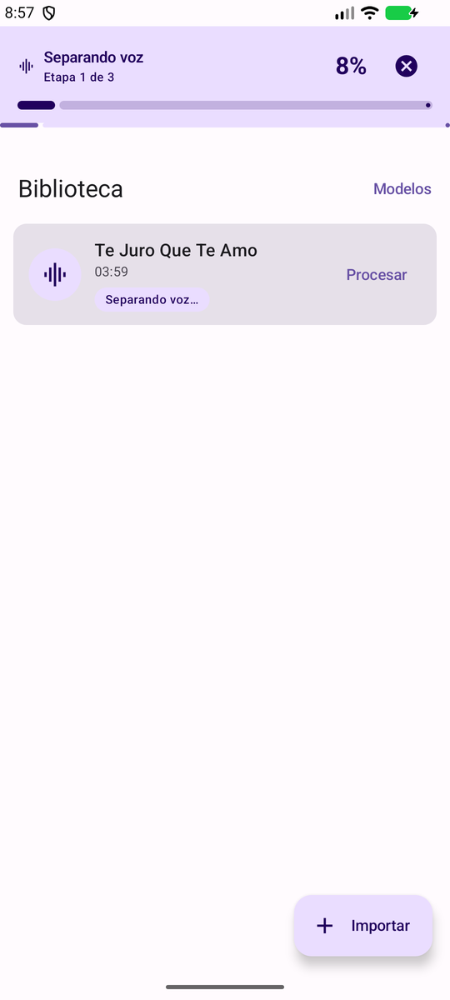
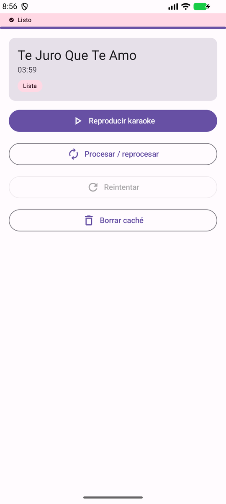
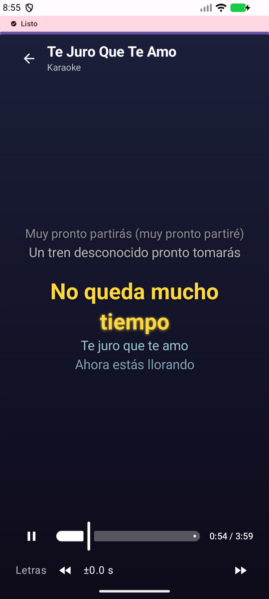
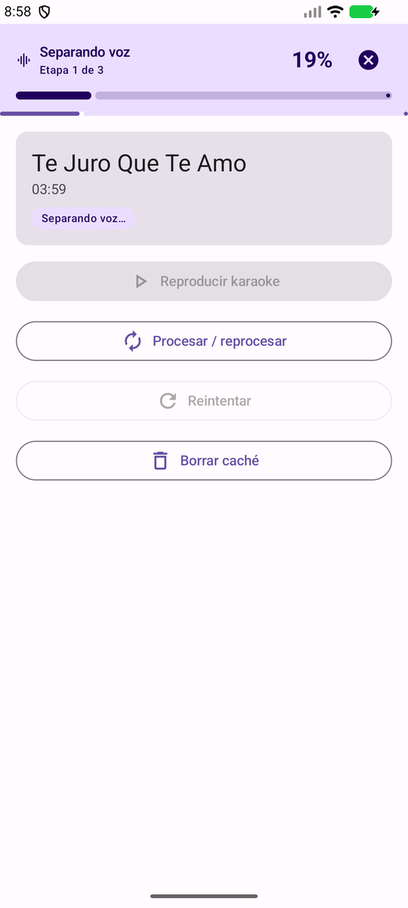
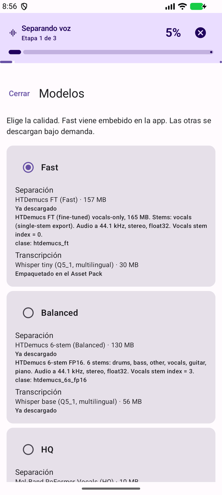

# KaraokIAndroid

[](https://github.com/TheJorseman/KaraokIAndroid/actions/workflows/ci.yml)
[](https://github.com/TheJorseman/KaraokIAndroid/actions/workflows/release.yml)

Android karaoke app that turns any local audio or video file into a
singable track. The user imports a song, the app isolates the vocal
melody with an on-device neural network, transcribes the lyrics with
`whisper.cpp`, and renders the karaoke view with word-by-word
highlighting. When internet is available it can fetch the *real*
lyrics and sync them onto the locally generated timestamps.

The whole audio pipeline runs on-device — the only network use is the
model manager (model downloads) and the opt-in online lyrics sync,
which sends just the title/artist/duration (never audio).

## Screenshots

| Library | Song detail |
| --- | --- |
|  |  |

| Karaoke player (real lyrics, word sync) | Pipeline progress |
| --- | --- |
|  |  |



## Current status

| Area | Status |
| --- | --- |
| Kotlin / Compose UI | ✅ Verified end-to-end on an emulator (API 36) and a Galaxy S24 Ultra |
| Separation — Fast (HTDemucs FT, FP16 weights) | ✅ Downloaded on demand (165 MB), overlap-add streaming |
| Separation — Balanced (HTDemucs 6-stem FP16) | ✅ Downloaded on demand (136 MB) |
| Separation — HQ (Mel-Band RoFormer FP16 + 741 MB sidecar) | ✅ Downloaded on demand |
| Transcription — Fast (Whisper tiny multilingual) | ✅ Embedded in APK (30.7 MB), `whisper.cpp` GGML |
| Transcription — Balanced / HQ (Whisper base / small) | ✅ Downloaded on demand |
| Karaoke lyrics engine | ✅ Word-level timing, line composition, display normalization |
| Online lyrics sync (LRCLIB) | ✅ Real lyrics + DTW alignment to local timestamps, auto offset calibration |
| Storage Access Framework import | ✅ SAF picker, Room cache by SHA-256 of contents |
| Foreground Service for long pipeline | ✅ Determinate progress bar per stage, cooperative cancel |
| Default song | ✅ "Te Juro Que Te Amo" MP3 bundled in APK |
| Launcher icon + themed icon (monochrome) | ✅ Adaptive icon (mic + note), per-density fallbacks |

## Repository layout

```
app/                        Compose app, navigation, foreground service
core/
  ai/                       ONNX session helpers, FP16→FP32 model upcast
  common/                   Result / coroutines / hash / title utilities
  data/                     Room + DataStore + catalog sync DAOs
  designsystem/             Reusable composables (progress banner, theme)
  media/                    Audio extraction (mp3/flac/wav/m4a/mp4/mkv)
  whisper-jni/              whisper.cpp JNI bridge + streaming transcriber
docs/                       Architecture + perf comparison + changelog
feature/
  import/                   SAF song picker
  karaoke-engine/           Pure-Kotlin timing: lines/words, LRC parser,
                            lyrics aligner (DTW), offset calibrator
  karaoke-player/           Compose lyrics view + Media3 playback
  library/                  Library / song detail screens
  model-manager/            Catalog + downloads + LRCLIB lyrics client
  onboarding/               First-run screen
  pipeline/                 Orchestrator + progress state
  separation/               Fast / Balanced / HQ separators
  transcription/            Whisper glue + silence detection
scripts/
  devtools/                 adb / git / audio-diagnosis helpers
  fetch_whisper.ps1         Pins whisper.cpp at a fixed commit
  models/                   Download / quantize / verify model graphs
  tests/                    Python unit + emulator integration tests
third_party/whisper.cpp/    (ignored) cloned by scripts/fetch_whisper.ps1
```

## What the user sees

1. On first launch the demo song is imported into the library: the
   bundled "Te Juro Que Te Amo" MP3 when the build includes it, or a
   generated synthetic tune otherwise. Processing is started from the
   song's detail screen ("Procesar / reprocesar") and runs in a
   foreground service with a determinate progress banner
   ("Separando voz · Etapa 1 de 3 · 42%") that advances through
   separation → transcription → alignment.
2. The karaoke player renders synced lyrics over the instrumental
   track: the active line wraps to multiple rows, previously/next
   lines fade in context, the current word lights up progressively,
   and during instrumental gaps the upcoming line is previewed.
3. With internet (opt-in in Modelos → "Sincronizar en línea"), the
   app fetches the real lyrics from [LRCLIB](https://lrclib.net) and
   rewrites `karaoke.json` so the *veridical* text is highlighted
   against the user's own recording — including automatic offset
   calibration against vocal onsets. Without a convincing match the
   local transcription is kept. Offline, the sync is retried
   automatically when a connection appears.
4. Tiers: `FAST` (HTDemucs FT + Whisper tiny), `BALANCED`
   (HTDemucs 6-stem + Whisper base) and `HQ` (Mel-Band RoFormer +
   Whisper small); separation/transcription models download on
   demand from Hugging Face with SHA-256 verification.

## Models

Bundled in the APK (offline-first):

| Asset | Size | Role | SHA-256 |
| --- | --- | --- | --- |
| `assets/transcription/ggml-tiny-q5_1.bin` | 30.7 MB | Fast transcription | `818710568da3ca15689e31a743197b520007872ff9576237bda97bd1b469c3d7` |

Optionally bundled (not tracked in git): the demo song
`assets/songs/te_juro_que_te_amo.mp3`; without it the seeder generates
a small synthetic tune so the pipeline is usable out of the box.

Downloaded on demand (see `app/src/main/assets/models/catalog.json`,
v9 — all URLs and checksums verified against upstream Hugging Face):

| Model | Tier | Size |
| --- | --- | --- |
| HTDemucs FT vocals (StemSplitio) | Fast separation | 165 MB |
| HTDemucs 6-stem FP16 (StemSplitio) | Balanced separation | 136 MB |
| Mel-Band RoFormer T=1100 (musetric) | HQ separation | 10 MB + 741 MB sidecar |
| Whisper base / small Q5_1 (ggerganov) | Balanced / HQ transcription | 58 MB / 181 MB |

## Build

The standard Android Studio toolchain:

```
gradlew :app:assembleDebug
```

The demo song "Te Juro Que Te Amo" is **not tracked in the repository**
(it is a copyrighted recording). To bundle it in your build, drop the
MP3 at `app/src/main/assets/songs/te_juro_que_te_amo.mp3` before
building; without it the app seeds a small generated synthetic tune
instead and everything else works the same.

### CI/CD

- `ci.yml` — every push/PR builds the debug APK and runs the JVM test
  suites on GitHub Actions (uploads the APK as a build artifact).
- `release.yml` — pushing a tag like `v1.2.0` (or running it manually
  from the Actions tab) builds and publishes the APK to GitHub
  Releases. Set the `KEYSTORE_BASE64` secret (base64 of the release
  keystore) for production-signed builds; without it a debug-signed
  APK is published so the pipeline works out of the box.

### Build environment

The Android Studio bundled JBR (`C:\Program Files\Android\Android
Studio\jbr`) is the only Java we tested with. The Android SDK is
expected at `C:\Users\migue\AppData\Local\Android\Sdk`;
`local.properties` is machine-specific and ignored.

`scripts/requirements.txt` lists the Python deps the smoke tests
and model tools need.

## Tests

### Kotlin / JVM

```
gradlew :app:assembleDebug :core:ai:testDebugUnitTest \
        :core:media:testDebugUnitTest :feature:separation:testDebugUnitTest \
        :feature:karaoke-engine:test
```

Includes the FP16→FP32 upcaster tests (synthetic ONNX fixture),
LRC parsing, DTW lyrics alignment (anchor transfer, interpolation,
offset measurement, rejection), offset calibration against synthetic
vocal onsets, karaoke line building/normalization and STFT checks.

### Python

```
PYTHONPATH=. KMP_DUPLICATE_LIB_OK=TRUE python -m pytest scripts/tests
```

Model smoke tests (`scripts/devtools/*_smoke`, `scripts.models.verify_models`)
exercise the production graphs on the host.

### Emulator / device

`scripts/tests/test_emulator_integration.py` drives `adb` to install
and run the app; `feature:separation:connectedDebugAndroidTest`
runs ORT inference checks on a live device.

## Runtime inference backends

`core:ai/OrtSessionFactory` selects the ORT execution provider:

- **CPU (default)** — the quality-verified path: on a Galaxy S24
  Ultra the separated vocals match the x86 reference bit-for-bit in
  our A/B checks.
- **NNAPI** — ~20% faster in our benchmarks (26.6 s vs 32.5 s per
  30 s of HTDemucs FT) but its output quality is not yet validated
  against the CPU reference; opt-in only.
- **XNNPACK** — CPU fallback EP, unvalidated for some graphs.

Notes from the performance investigation (SM8650, 12 GB device):

- Intra-op threads adapt to the device (cores/2, capped at 6 on
  ≥ 6 GB devices) instead of a fixed 2.
- **QNN (Qualcomm NPU)** was investigated end-to-end (Qualcomm
  plugin EP and Microsoft's `-qnn` build, every provider
  configuration, ADSP library path, extracted skels): `QnnDevice_create`
  fails with `QNN_DEVICE_ERROR_INVALID_CONFIG` on the tested Samsung
  firmware, and the plugin EP is not yet shipped for the current ORT
  on Android. The integration point is documented in `OrtSessionFactory`.
- Models with FP16 initializers are transparently rewritten to FP32
  once on ARM64 (`OnnxFp32Upcast`, streamed, cached as
  `<model>.fp32.onnx`) to bypass a corrupt FP16 path in the ORT CPU
  EP on devices; other ABIs use the original graphs.

## Known limitations

- **Whisper tiny is ASR-approximate.** Word timings are good but some
  words are garbled; the online lyrics sync exists precisely to fix
  the text while keeping local timing.
- **whisper.cpp on Android is CPU-only.** A TFLite/NNAPI port could
  cut transcription latency; out of scope today.
- **RoFormer INT8 is rejected by ORT** (`DynamicQuantizeLinear` on
  the FP16 export); the graph stays FP16→FP32 upcast.
- **The HQ RoFormer needs ~9 GB RSS while inferring** (measured);
  fine on 8–12 GB flagships, risky on low-RAM devices.

## Project conventions

- Pure-Kotlin modules (`core:common`, `feature:karaoke-engine`) ship
  no Android dependencies and stay unit-testable on the JVM.
- All cross-module Android code goes through Hilt; `AppResult<T>`
  and the `getOrThrow()` extension are the canonical error path.
- **Only `feature:model-manager` contains network logic** (model
  downloads and the LRCLIB lyrics client).
- The catalog (`assets/models/catalog.json`) is the source of truth
  for models: `CatalogSyncer` merges and prunes rows at startup, so
  stale rows from older versions can never win model selection.
- Room schema migrations are additive and never destructive.

## License notes

- App code: MIT.
- `whisper.cpp` (third_party): MIT, pinned by `scripts/fetch_whisper.ps1`.
- HTDemucs 6-stem / FT-Vocals: MIT, distributed at
  `huggingface.co/StemSplitio`.
- Mel-Band RoFormer vocals: MIT, distributed at
  `huggingface.co/musetric`.
- Whisper GGML models: MIT, distributed at
  `huggingface.co/ggerganov/whisper.cpp`.
- Lyrics fetched from [LRCLIB](https://lrclib.net) at the user's
  option; only title/artist/duration leave the device.

A proper SBOM is tracked in `TODO.md` (Release section).
